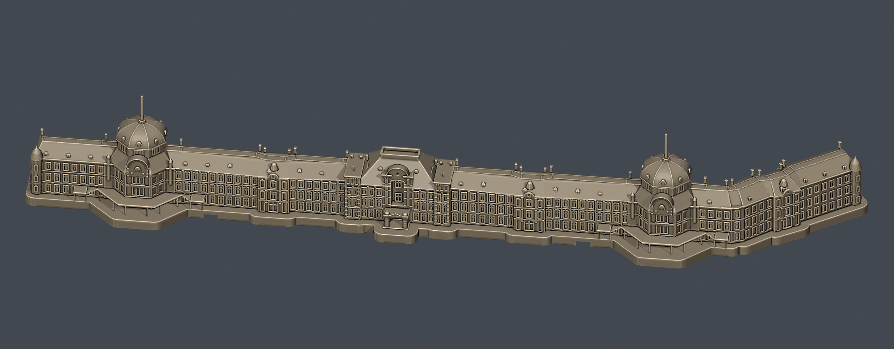
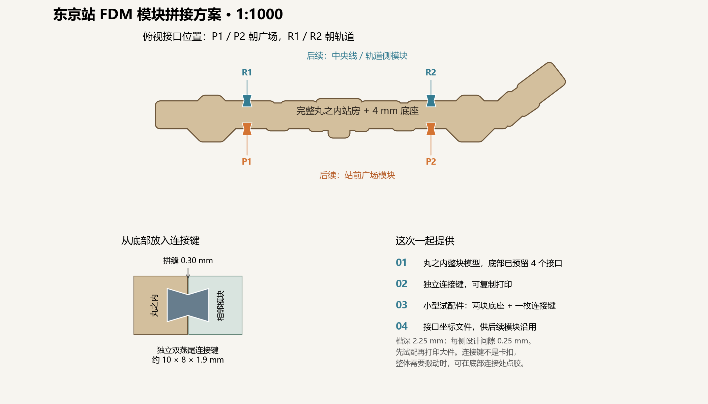

# 丸之内站房 FDM 打印版 · 1:1000

完整丸之内站房与一块 4 mm 底座合为一个实体。包含南北圆顶、中央入口、连续屋顶、立面窗列、南端转折和入口雨棚。打印范围为地上站房；站前广场、铁路与其他站台由后续模块接入。

这是单色实体版本。窗框、尖塔、雨棚支柱等为 0.4 mm 喷嘴加粗，内部补实，细小雕花作取舍。模型基于本仓库 V22 的摄影解释模型，整体比例为 1:1000，局部打印加强不严格等比。



## 文件与尺寸

| 文件 | 用途 |
|---|---|
| `Marunouchi_H2C_PLA_0.12mm.3mf` | Bambu Studio H2C 工程，包含排版、打印设置和已验证的切片 |
| `Marunouchi_H2C_1-1000.3mf` | 毫米单位的通用 3MF，按 H2C 共同打印区摆放 |
| `Marunouchi_1-1000.stl` | 334.424 × 64.946 × 50.100 mm，长轴未旋转 |
| `Marunouchi_FDM_1-1000.blend` | Blender 原生打印模型及预览相机 |
| `Connector_key.stl` | 独立双燕尾连接键；每个接口使用一枚 |
| `Connector_fit_test.stl` / `.3mf` | 两块小底座和一枚连接键，用于先试配 |
| `assembly_interfaces.json` | 后续模块必须沿用的边界、接口坐标和公差 |

站房在打印板上旋转 42°，占地约 237.416 × 254.670 mm。按 H2C 两喷嘴共同范围 X=25–325、Y=0–320 mm 居中摆放，模型距边界至少约 31.29 mm，留有裙边和支撑空间。导入 STL 时保持毫米单位、100% 缩放；通用 3MF 已包含尺寸与摆放坐标。

## 拼接方法



所有地面模块的底座统一为 4 mm 厚。本块底部已有四个开口定位槽：P1/P2 朝站前广场，R1/R2 朝铁路。相邻模块将沿同一基准轮廓生成，预留 0.30 mm 拼缝，并使用坐标文件中的同一连接键中心。

独立连接键约 10 × 8 × 1.9 mm，槽深 2.25 mm，每侧设计间隙 0.25 mm。两块摆齐后，从底部放入连接键；键同时进入两边的半槽，约束平面位移。它是定位连接，不是弹性卡扣。桌面静置可保留可拆装方式；需要整体搬动时，可在底部连接处少量点胶或安装统一托板。

先打印 `Connector_fit_test`，清理槽内支撑、毛边和象脚后试配。实际配合受耗材、流量与首层设置影响，本版尚未实机试打。试配太紧时，可只把连接键的 X/Y 缩小到 98–99%，保持 Z=100%；不要缩放整栋站房，否则会破坏整体比例和后续接口坐标。

图中的广场与铁路模块属于后续计划；本包已完成站房、四个接口、独立连接键和试配件。

## 打印设置与验证

H2C 工程采用 0.4 mm 喷嘴、Generic PLA、纹理 PEI 板、0.12 mm 层高、3 道墙、12% Gyroid 填充、自动树状支撑及 3 mm 外裙边。打开工程后按实际耗材和打印板检查设置并重新切片。支撑主要用于雨棚、门廊和局部悬挑。

Bambu Studio 02.08.02.60 对最终带接口的模型切片成功，返回码 0、警告为空；估算约 10 小时 2 分、92.6 g PLA，包含本次支撑和裙边，实际用量与耗时以你重新切片的结果为准。

验证包括 STL 导出后重新读取、封闭网格、统一面朝向、单个连通主体、正体积、3MF 毫米单位与体积一致、H2C 平面边界余量、四个连接键安装位置与站房零体积干涉。模型为 2,479,684 个三角面。几何与切片验证不代替实机试配。

## 复现

需要 Blender 5.2，以及 Python 的 numpy、scipy、trimesh、manifold3d、shapely、networkx。命令中的目录为示例，换成自己的路径。

```text
blender -b Tokyo_Station_Chuo_Roof_V22.blend --python-exit-code 1 --python scripts/export_marunouchi_fdm_source.py -- build/fdm_source
python scripts/build_marunouchi_fdm.py --source build/fdm_source --out build/Marunouchi_FDM
blender -b --python-exit-code 1 --python scripts/regularize_marunouchi_fdm.py -- build/Marunouchi_FDM
python scripts/finalize_marunouchi_fdm.py build/Marunouchi_FDM
blender -b --python-exit-code 1 --python scripts/preview_marunouchi_fdm.py -- build/Marunouchi_FDM
```

先合并建筑实体、加固并生成接口，再以 0.12 mm 体素消除渲染网格的极薄重合接缝。最终文件重新读取验证通过后导出。V22 原始场景 SHA-256 保持为 `11c1e3d349cbb168c162ed265f9487f14018803bc8dcccb4e25caedce9de78ac`。
